# 🛰️ AI-Ops Sentinel

<p align="center">
  <strong>Multi-Modal Anomaly Detection and Explainability for Cloud Microservices</strong>
</p>

<p align="center">
  
  
  
  
  
  
</p>

AI-Ops Sentinel is an intelligent system-monitoring and anomaly-detection platform for cloud microservices. It brings together operational signals from **logs, metrics, and traces** to identify unusual system behaviour, combine anomaly signals, and support investigation with explainability techniques.

The project combines a **VAE-LSTM anomaly detector**, an **Isolation Forest baseline**, log preprocessing, feature extraction, anomaly fusion, and explanation components behind a FastAPI backend and a React dashboard.

> **Project status:** AI-Ops Sentinel is an active academic/research project. The repository contains the detection, preprocessing, explanation, API, dashboard, and microservice components described below. Setup and runtime behaviour may require configuration for the local environment and input datasets. Do not interpret the project as a production-ready monitoring service.

---

## 📋 Table of Contents

- [Project Overview](#-project-overview)
- [Problem Statement](#-problem-statement)
- [Key Features](#-key-features)
- [System Workflow](#-system-workflow)
- [Architecture](#-architecture)
- [Tech Stack](#-tech-stack)
- [Detection and Explainability](#-detection-and-explainability)
- [Repository Structure](#-repository-structure)
- [Dataset and Data Organization](#-dataset-and-data-organization)
- [Installation Guide](#-installation-guide)
- [Running Locally](#-running-locally)
- [Microservice Container](#-microservice-container)
- [Monitoring Integration](#-monitoring-integration)
- [API Documentation](#-api-documentation)
- [Configuration](#-configuration)
- [Screenshots](#-screenshots)
- [Current Scope and Limitations](#-current-scope-and-limitations)
- [Future Improvements](#-future-improvements)
- [Contributing](#-contributing)
- [License](#-license)

---

## 🧾 Project Overview

Modern cloud-native applications are distributed across multiple services. A failure in one service can produce symptoms across several observability signals: unusual metrics, unexpected log patterns, and abnormal traces. Investigating these signals independently can make it difficult to identify the source and understand the impact of an incident.

AI-Ops Sentinel explores a multi-modal approach to operational anomaly detection. It processes system telemetry, extracts useful features, applies machine-learning-based detection, and combines anomaly information to support a more informed investigation workflow.

The project focuses on three signal categories:

| Signal | Purpose |
| --- | --- |
| **Metrics** | Represent numerical system behaviour over time. |
| **Logs** | Capture application and service events that may indicate abnormal behaviour. |
| **Traces** | Represent request paths and interactions across distributed services. |

The platform is organized around a Python-based processing and detection layer, a FastAPI backend, and a React dashboard.

## 🎯 Problem Statement

Traditional monitoring often relies on fixed thresholds and separate views for logs, metrics, and traces. This can make it harder to detect complex or early-stage incidents whose symptoms appear across different telemetry sources.

AI-Ops Sentinel investigates the following question:

> How can multiple observability signals be processed and combined to detect anomalous behaviour in cloud microservices, while providing useful explanations that help an engineer investigate the detected events?

The goal is to support anomaly identification and investigation—not to replace human operational decisions.

## ✨ Key Features

| **Component** | **Purpose** |
| --- | --- |
| **Multi-modal telemetry processing** | Works with log, metric, and trace-related data. |
| **Log preprocessing** | Processes raw log data and extracts structured event information. |
| **Metric preprocessing** | Prepares numerical telemetry for downstream feature processing and detection. |
| **Feature extraction** | Uses scaling and dimensionality-reduction techniques, including StandardScaler and PCA in the data workflow. |
| **VAE-LSTM detector** | Learns patterns in sequential data and uses reconstruction behaviour for anomaly detection. |
| **Isolation Forest baseline** | Provides a baseline unsupervised anomaly-detection approach for comparison. |
| **Anomaly fusion** | Combines detector outputs and related features into a consolidated anomaly dataset. |
| **Explainability** | Includes SHAP-based and VAE-oriented explanation components to support investigation. |
| **Log event processing** | Includes Drain3-based log-template processing in the log analysis workflow. |
| **Fault injection support** | Includes a module for introducing fault scenarios during experimentation. |
| **Live collection component** | Includes a collector module for live telemetry workflows. |
| **REST API** | Exposes backend functionality through FastAPI. |
| **Dashboard** | Provides a React-based interface for presenting monitoring and anomaly information. |
| **Containerized microservice** | Includes a separate microservice application and Dockerfile. |

> Feature availability depends on the selected data, configuration, and execution path. The presence of a module in the repository does not imply that every workflow is deployed or running continuously.

## 🔄 System Workflow

The high-level workflow is:

1. **Telemetry input** — provide logs, metrics, and trace-related data.
2. **Preprocessing** — clean and prepare the input data for analysis.
3. **Feature engineering** — transform raw signals into structured numerical or event-based features.
4. **Anomaly detection** — run the VAE-LSTM detector and baseline detection workflow.
5. **Anomaly fusion** — combine relevant outputs into a consolidated view.
6. **Explanation** — generate supporting information to help interpret detected anomalies.
7. **API and visualization** — make the resulting information available to the backend and dashboard.
8. **Investigation** — use the displayed anomaly information as a starting point for further analysis.

## 🏗 Architecture

The following diagram illustrates the logical flow between the main project components. It is a conceptual overview; exact runtime connections depend on the selected execution configuration.

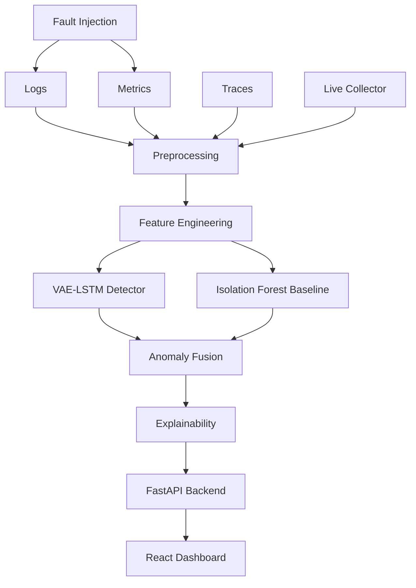

### Main layers

| Layer | Responsibility |
| --- | --- |
| **Data layer** | Stores source datasets and processed telemetry outputs. |
| **Preprocessing layer** | Converts raw logs and metrics into analysis-ready inputs. |
| **Detection layer** | Runs sequential and baseline anomaly-detection approaches. |
| **Fusion layer** | Consolidates anomaly-related outputs. |
| **Explainability layer** | Produces information intended to help interpret model outputs. |
| **Backend layer** | Serves application functionality through FastAPI. |
| **Presentation layer** | Displays system and anomaly information in the React dashboard. |

## 🛠 Tech Stack

| **Area** | **Technologies** |
| --- | --- |
| **Programming** | Python, JavaScript |
| **Backend** | FastAPI |
| **Frontend** | React, Vite |
| **Machine Learning** | PyTorch, scikit-learn |
| **Data Processing** | NumPy, Pandas, PyArrow |
| **Anomaly Detection** | VAE-LSTM, Isolation Forest |
| **Explainability** | SHAP, VAE-oriented explanation module |
| **Log Processing** | Drain3 |
| **Dimensionality Reduction** | PCA |
| **Feature Scaling** | StandardScaler |
| **Monitoring** | Prometheus, Grafana |
| **Containerization** | Docker |

## 🧠 Detection and Explainability

### 1. VAE-LSTM

The project includes a Variational Autoencoder–Long Short-Term Memory (VAE-LSTM) model for sequential anomaly detection.

At a high level:

1. Sequential input data is prepared through the preprocessing workflow.
2. The model learns patterns from the input sequences.
3. Reconstruction behaviour is used as an anomaly signal.
4. The resulting scores and flags can be used in downstream analysis and fusion.

The repository includes a model implementation in `model/vae_lstm.py` and a saved model artifact at `model/vae_model.pth`.

### 2. Isolation Forest baseline

Isolation Forest is included as a baseline anomaly-detection method. It provides a second detection approach that can be compared with the sequential model workflow.

### 3. Log processing with Drain3

Drain3 is used in the log-processing workflow to identify log templates from raw log messages. Template-based representations can help convert unstructured log lines into structured event information.

### 4. Explainability

The repository includes explanation-related modules:

- `model/explainer.py` — SHAP-oriented explanation logic.
- `model/vae_explainer.py` — VAE-related explanation logic.
- `data/explanations.json` and `data/vae_explanations.json` — saved explanation outputs.

These components are intended to provide additional context for interpreting anomaly-detection outputs. Explanation quality and availability depend on the model, input data, and execution configuration.

## 📁 Repository Structure

The main project layout is organized as follows:

```text
AI-Ops-Sentinel/
├── api/
│   └── main.py                    # FastAPI application entry point
│
├── dashboard/
│   └── src/
│       └── App.jsx                # Main React dashboard component
│
├── data/
│   ├── sequential_data/            # Sequential telemetry data
│   ├── anomalies.csv               # Anomaly output data
│   ├── anomalies_with_faults.csv   # Anomaly data with fault-related fields
│   ├── fused_anomalies.csv         # Consolidated anomaly output
│   ├── live_anomalies.csv          # Live workflow output
│   ├── explanations.json           # Explanation output
│   ├── vae_anomalies.csv            # Original VAE anomaly output
│   ├── vae_anomalies_processed.csv # Processed VAE-related dataset
│   └── vae_explanations.json        # VAE explanation output
│
├── microservice/
│   ├── app.py                      # Microservice application
│   ├── Dockerfile                  # Container build instructions
│   └── requirements.txt            # Microservice dependencies
│
├── model/
│   ├── detector.py                 # Baseline detection logic
│   ├── explainer.py                # Explanation logic
│   ├── fault_injection.py          # Fault injection utilities
│   ├── fusion.py                   # Anomaly fusion logic
│   ├── live_collector.py           # Live telemetry collection
│   ├── vae_explainer.py            # VAE explanation logic
│   ├── vae_lstm.py                 # VAE-LSTM model
│   └── vae_model.pth               # Saved model weights
│
├── preprocessing/
│   ├── logs_preprocess.py          # Log preprocessing
│   └── metrics_preprocess.py       # Metric preprocessing
│
├── requirements.txt                # Main Python dependencies
├── .gitignore
└── README.md
```

Additional files and data artifacts may exist in the repository beyond the main components shown above.

## 📊 Dataset and Data Organization

The project uses the **LO2 dataset** in its telemetry-analysis workflow. The repository also contains sequential data and derived outputs used by the preprocessing, detection, fusion, and explanation components.

Examples of data artifacts include:

| **File** | **Description** |
| --- | --- |
| `data/anomalies.csv` | Anomaly-related output data. |
| `data/anomalies_with_faults.csv` | Anomaly output containing fault-related information. |
| `data/fused_anomalies.csv` | Consolidated anomaly output. |
| `data/live_anomalies.csv` | Output associated with the live collection workflow. |
| `data/vae_anomalies.csv` | Original VAE reconstruction-error and anomaly-flag output. |
| `data/vae_anomalies_processed.csv` | Processed VAE-related dataset with additional feature columns. |
| `data/explanations.json` | Saved explanation information. |
| `data/vae_explanations.json` | Saved VAE explanation information. |

**Data note:** The CSV files listed above are derived artifacts and may represent different stages of the processing pipeline. They should not be treated as interchangeable datasets. In particular, `vae_anomalies.csv` and `vae_anomalies_processed.csv` have different schemas.

Some source data files are large. If you are reproducing the experiments, make sure you have the required input data in the expected directory structure.

## 🚀 Installation Guide

### Prerequisites

Install the following tools before running the project:

- Python 3.14 (the development environment used for this project)
- Node.js and npm
- Git
- A code editor such as Visual Studio Code
- Docker Desktop (only for the containerized microservice workflow)
- Prometheus and Grafana (if running the monitoring integration)

### 1. Clone the repository

```bash
git clone https://github.com/raqheeb/AI-Ops-Sentinel.git
cd AI-Ops-Sentinel
```

### 2. Create a Python virtual environment

**Windows PowerShell:**

```powershell
python -m venv .venv
.\.venv\Scripts\Activate.ps1
```

**macOS / Linux:**

```bash
python3 -m venv .venv
source .venv/bin/activate
```

### 3. Install Python dependencies

```bash
python -m pip install --upgrade pip
pip install -r requirements.txt
```

### 4. Install dashboard dependencies

```bash
cd dashboard
npm install
```

Return to the project root when you need to run backend or data-processing commands:

```bash
cd ..
```

> If dependency installation fails, check the Python and Node.js versions and the package versions supported by the local environment.

## 💻 Running Locally

The backend and dashboard are separate applications and should be started in separate terminals.

### Start the FastAPI backend

From the project root, with the Python virtual environment activated:

```bash
uvicorn api.main:app --reload
```

The command assumes that the FastAPI instance in `api/main.py` is named `app`. If the application object or import path has a different name in your local version, use the corresponding Uvicorn import string.

### Start the React dashboard

In a second terminal:

```bash
cd dashboard
npm run dev
```

The Vite development server commonly runs at:

```text
http://localhost:5173
```

Use the local URL printed by Vite if a different port is selected.

## 🐳 Microservice Container

A separate microservice directory contains an application, Dockerfile, and its own dependency file.

Build the image from the repository root:

```bash
docker build -t aiops-sentinel-microservice ./microservice
```

The container's required environment variables, exposed port, and runtime command should be checked in `microservice/app.py` and `microservice/Dockerfile` before running it in a customized environment.

## 📈 Monitoring Integration

Prometheus and Grafana are part of the project's monitoring technology stack.

- **Prometheus** is used for metrics collection and monitoring workflows.
- **Grafana** is used for monitoring dashboards and visualization.

The exact scrape targets, exporter configuration, and dashboard provisioning depend on the local monitoring setup. Configure these integrations using the relevant project configuration files available in your working copy.

## 📚 API Documentation

The backend is built with FastAPI. When the API is running and interactive documentation is enabled, the standard FastAPI documentation pages are available at:

```text
http://127.0.0.1:8000/docs
http://127.0.0.1:8000/redoc
```

The actual API routes and request schemas are defined in `api/main.py`. Refer to that file for the current endpoint implementation.

## ⚙️ Configuration

Configuration requirements can vary depending on the workflow being run.

Before starting the application:

1. Inspect the backend and microservice source files for required environment variables.
2. Check whether local dataset paths match the repository's data layout.
3. Confirm that model-weight paths point to the intended checkpoint.
4. Verify that any Prometheus or Grafana configuration points to the correct local services.
5. Do not commit API keys, passwords, tokens, private keys, or local `.env` files.

If environment variables are required, document their names and safe example values in an `.env.example` file. Keep actual credentials in a local environment file that is excluded by `.gitignore`.

## 🖼 Screenshots

The following screenshots showcase the AI-Ops Sentinel dashboard, anomaly detection outputs, model comparison, live microservice monitoring, and explainability views.

### 1. Anomaly Dashboard Overview
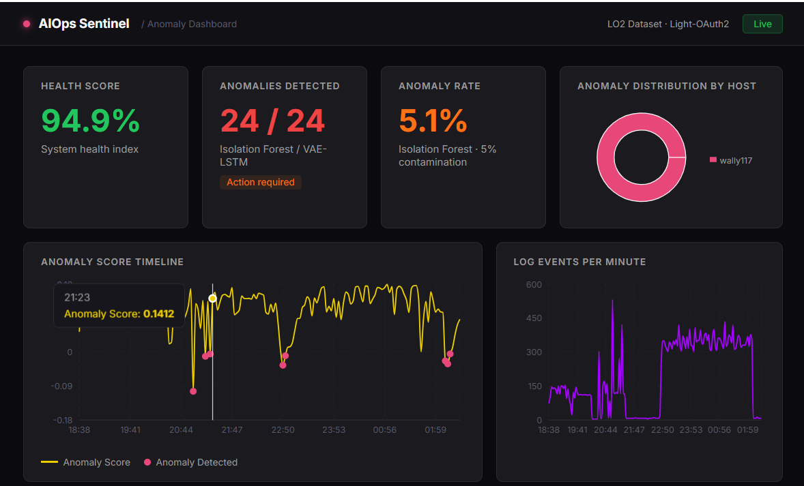

### 2. Isolation Forest Anomaly Events
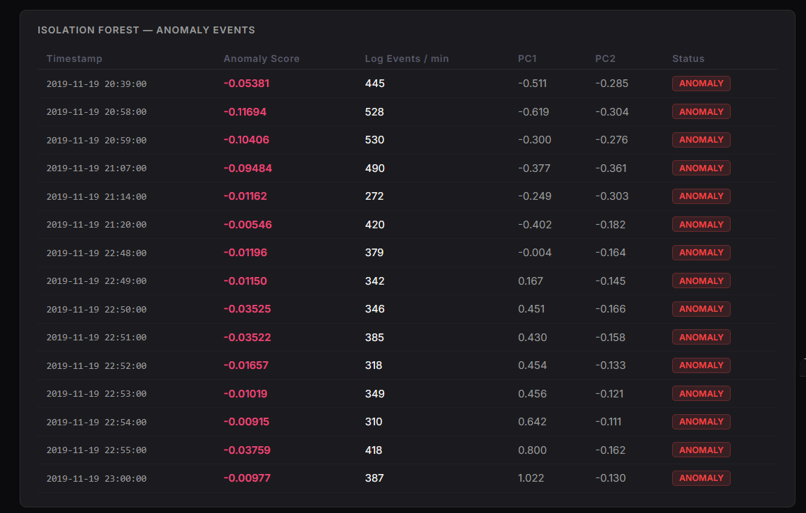

### 3. VAE-LSTM Anomaly Events
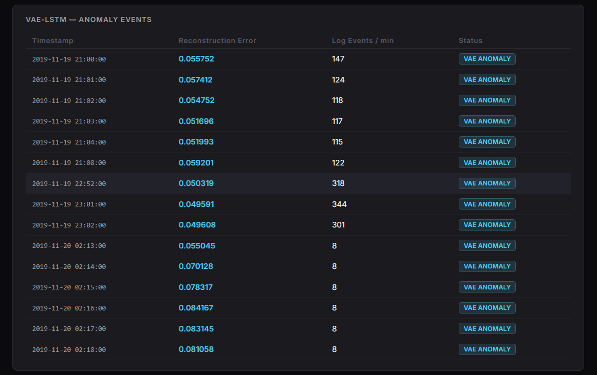

### 4. Model Agreement: Isolation Forest vs VAE-LSTM
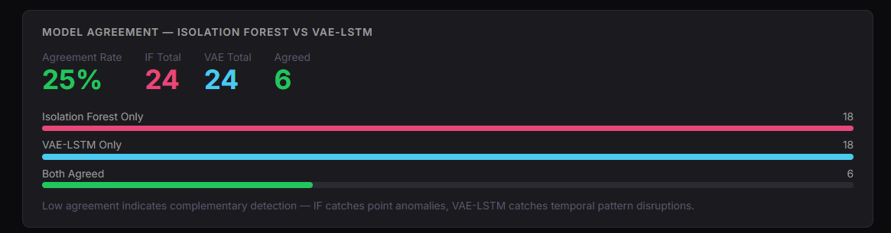

### 5. Live Microservice Anomaly Monitor
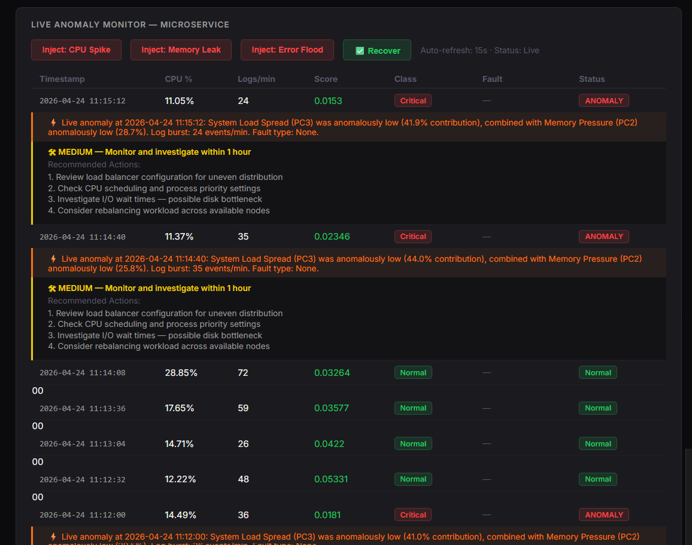

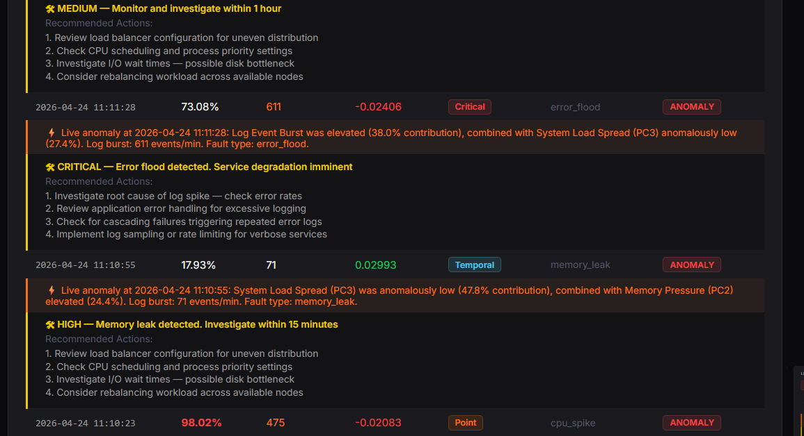

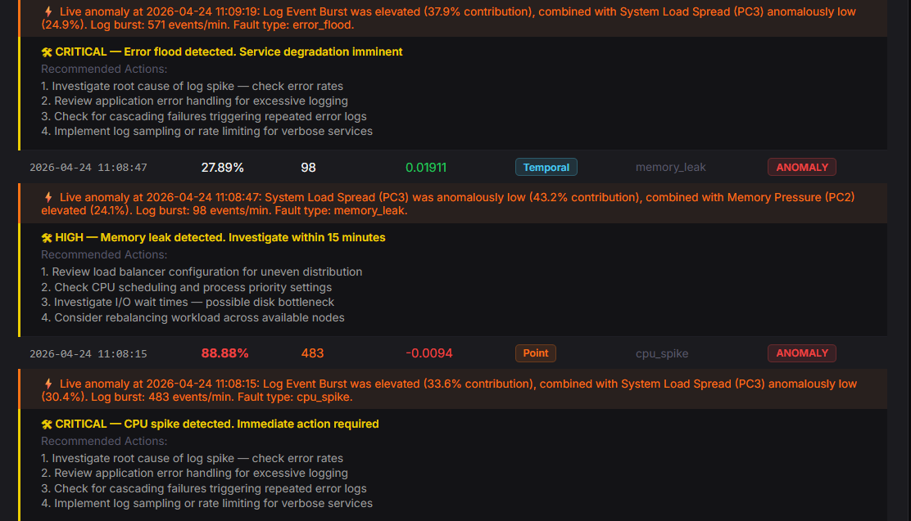

### 6. SHAP Fault Explanations
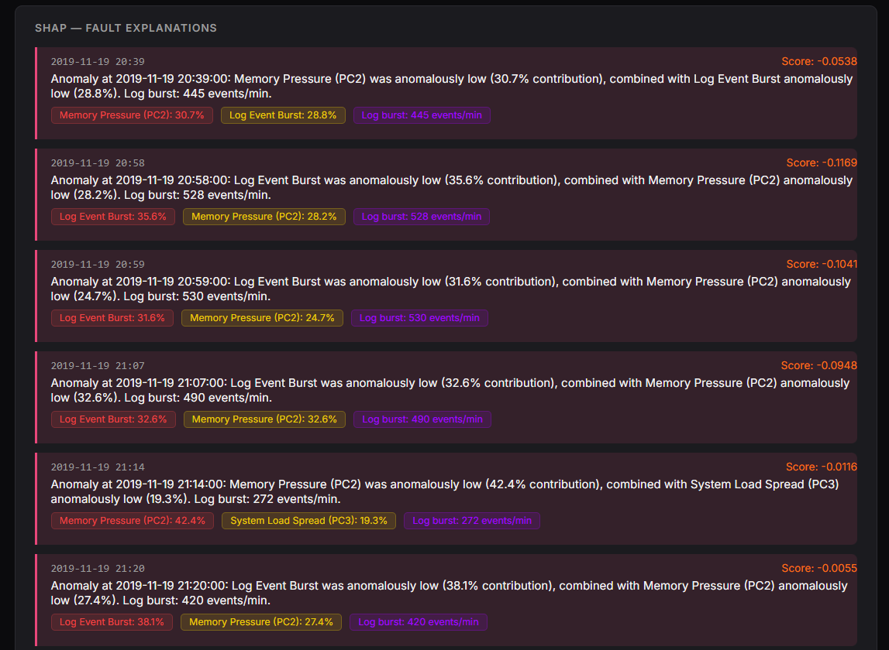

### 7. VAE-LSTM Temporal Anomaly Explanations
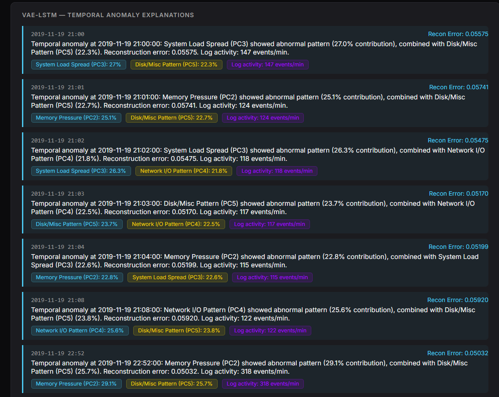

### 8. Worst Anomaly Event and System Information
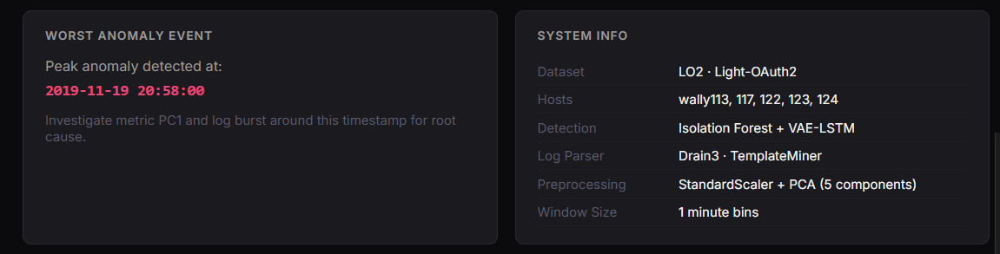

## ⚠️ Current Scope and Limitations

- This repository represents an academic/research project under development, not a fully hardened production monitoring platform.
- Detection quality depends on the input data, preprocessing, model configuration, and selected thresholds.
- The log, metric, and trace workflows may require dataset-specific preparation.
- The presence of live collection and fault-injection modules does not by itself mean that a complete production deployment is configured.
- Prometheus and Grafana setup may require additional local configuration.
- Reproducibility depends on using compatible dependency versions and the expected dataset layout.
- Large source-data artifacts may take time to clone and transfer.

## 🔭 Future Improvements

Potential next steps for the project include:

- Complete and document an end-to-end telemetry ingestion workflow.
- Standardize the schemas shared by log, metric, and trace processing.
- Evaluate VAE-LSTM and baseline models using clearly documented metrics.
- Add repeatable experiments and automated evaluation scripts.
- Improve anomaly correlation and root-cause investigation across telemetry sources.
- Expand explanation outputs to connect detected anomalies with relevant features and events.
- Add automated tests for preprocessing, detection, fusion, and API components.
- Improve dashboard drill-down and incident investigation workflows.
- Document Prometheus and Grafana setup with reproducible configuration.
- Add a deployment guide for running the components together.

## 🤝 Contributing

Contributions, bug reports, and suggestions are welcome.

1. Fork the repository.
2. Create a feature branch.
3. Make focused changes and document relevant configuration.
4. Test the affected workflow.
5. Submit a pull request describing the change.

## 📄 License

See the [`LICENSE`](LICENSE) file in the repository for licensing terms.

---

<p align="center">
  Built as an academic project exploring multi-modal observability, machine learning, and explainable anomaly detection for cloud microservices.
</p>

